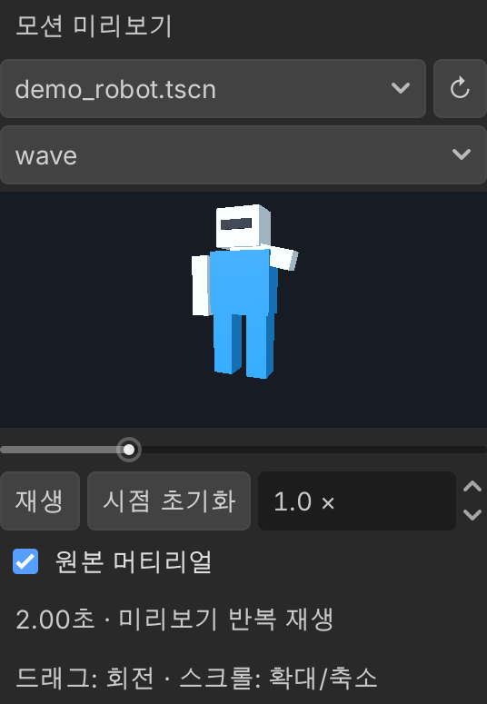
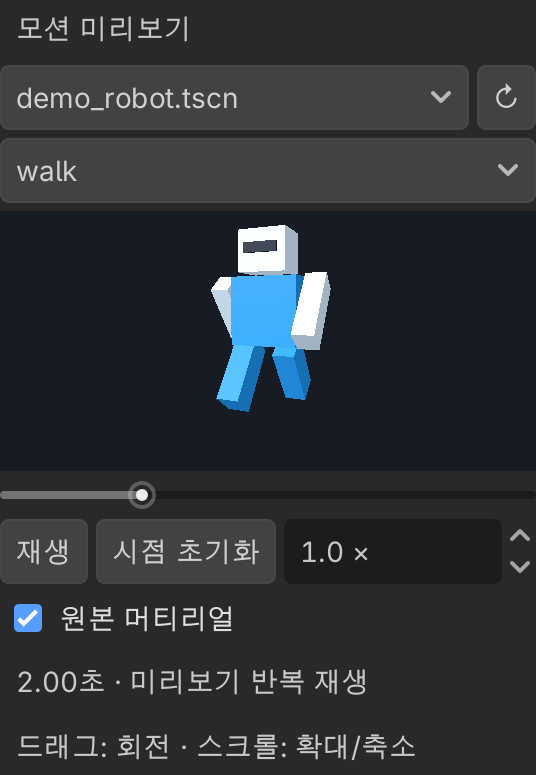

# Motion Preview

**한국어** | [English](README.en.md)

## 소개

Godot에서 애니메이션 라이브러리(`AnimationLibrary`)를 선택하면 인스펙터에서 3D 모델에 적용한 모션을 미리 보는 에디터 플러그인입니다. 게임을 실행하거나 미리보기 씬을 따로 만들지 않고 여러 모션을 확인할 수 있습니다. Godot 4.7 이상을 대상으로 합니다.

| 손 흔들기 자세 | 걷기 자세 |
|---|---|
|  |  |

데모 모델을 사용한 실제 인스펙터 화면입니다. [전체 에디터 화면 보기](docs/images/motion-preview-editor.png)

## 게임 프로젝트에서 설치하고 사용하기

### 설치

1. 이 저장소의 Releases에서 플러그인을 다운로드하고 압축을 풉니다.
2. `motion_preview` 폴더를 게임 프로젝트의 `addons/`에 넣습니다. 최종 경로는 `addons/motion_preview/plugin.cfg`가 되어야 합니다.
3. Godot에서 **프로젝트 → 프로젝트 설정 → 플러그인**을 열고 **Motion Preview**를 켭니다.
4. 모델과 애니메이션의 임포트가 끝날 때까지 기다립니다.

업데이트하거나 제거하기 전에는 플러그인을 끄거나 에디터를 닫습니다. 업데이트할 때는 기존 플러그인 폴더를 새 버전으로 교체합니다.

### 사용

1. 파일시스템에서 `AnimationLibrary`로 임포트한 FBX 또는 `.tres` / `.res` 애니메이션 라이브러리를 **한 번 클릭**합니다. FBX를 더블클릭하면 Godot의 임포트 설정이 열립니다.
2. 인스펙터 미리보기의 **모델 선택…** 메뉴에서 모델을 고릅니다.
3. 첫 애니메이션이 반복 재생됩니다. 여러 애니메이션이 있으면 클립 메뉴에서 바꿉니다.

- **일시정지 / 재생**, 시간 슬라이더, **0.1~3배속**으로 모션을 확인합니다. 시간 슬라이더를 움직이면 일시정지합니다.
- 드래그로 시점을 회전하고 스크롤로 확대·축소합니다. **시점 초기화**를 누르면 모델 전체가 보이는 구도로 돌아갑니다.
- **원본 머티리얼**을 켜면 자세 확인용 무광 머티리얼 대신 모델의 머티리얼을 표시합니다.
- 다른 라이브러리를 선택하거나 에디터를 다시 열어도 마지막 모델 선택을 유지합니다.
- 모델 목록은 추가·이동·재임포트 후 갱신됩니다. **↻**로 직접 새로 고칠 수도 있습니다.

### 사용할 모델과 애니메이션

모델은 프로젝트 전체의 **FBX·GLB 파일**에서 찾습니다. `.tscn`·`.scn`·`.gltf`는 모델 목록과 일반 모델 로드에서 제외합니다. 스크립트가 없고 실제 메시가 있으며, **골격이 하나이거나 `Skeleton3D → RetargetModifier3D → Skeleton3D`로 연결된 두 골격 구조**인 모델을 지원합니다. 두 골격 모델은 구동 골격에 모션을 적용하고 기존 modifier로 메시용 골격을 갱신합니다. 서로 독립된 여러 골격과 골격 없는 소품은 제외합니다. 임포트된 모델을 사용하므로 Godot의 골격 보정 설정을 유지합니다.

인간형 모션은 골격이 다른 모델에도 자동으로 적용해 미리볼 수 있습니다. 일부 본이 없는 모델은 적용 가능한 움직임만 재생합니다. 보정 또는 생략된 움직임이 있으면 하단에 **노란색 경고**를, 재생할 수 없으면 **빨간색 오류**를 표시합니다.

자동 적용이 안 되는 모델은 Godot 고급 임포트 설정에서 `SkeletonProfileHumanoid`와 `BoneMap`을 확인해 주세요. 다른 골격으로 보정할 때는 모션의 원본 FBX·GLB·glTF가 필요할 수 있습니다.

본의 위치·회전·스케일 애니메이션을 재생하며, 메서드 호출·오디오·일반 속성 트랙은 재생하지 않습니다. 루트 모션으로 모델이 화면 밖으로 이동할 수 있으며, 제자리 고정 기능은 없습니다. 원본 모델·애니메이션과 현재 편집 씬은 변경하지 않습니다.

## 소스를 받아 수정하기

저장소를 클론한 뒤 다음 순서로 작업합니다.

1. Godot에서 `project.godot`을 엽니다. 플러그인은 기본으로 활성화되어 있습니다.
2. `addons/motion_preview/` 아래의 GDScript를 수정합니다. 직접 준비한 모델과 애니메이션을 개발 프로젝트에 넣으면 에디터에서 동작을 확인할 수 있습니다.
3. 변경 후 아래 회귀 검사로 기존 기능이 유지되는지 확인합니다.
4. 아래 배포 스크립트로 ZIP을 만든 뒤 원하는 게임 프로젝트에 설치합니다.

### 기존 기능의 회귀 검사

새 기능을 추가하면서 기존 동작을 깨뜨리지 않았는지 확인하는 테스트입니다. 임시 프로젝트에 간단한 모델과 애니메이션을 직접 생성하므로 외부 에셋 없이 실행할 수 있습니다.

- 라이브러리를 선택하면 미리보기가 나타나고, 모델을 찾아 선택할 수 있는지 확인합니다.
- 시간 슬라이더를 움직이면 모델의 본 자세가 바뀌는지 확인합니다.
- 다른 라이브러리 선택과 플러그인 재활성화 후에도 모델 선택이 유지되는지 확인합니다.
- 초기 구도와 표시 영역 크기 변경 시 모델이 화면에 들어오는지, 사용자가 조절한 시점은 유지되는지 확인합니다.

Godot 실행 파일과 Python 3을 준비하고 저장소 루트에서 실행합니다. `godot`이 PATH에 없으면 실행 파일 경로로 바꿉니다.

```sh
godot --headless --path . --editor --quit
python3 tests/check_motion_preview_portability.py godot
godot --headless --path . --script tests/motion_preview_retarget.gd
```

검사에 실패하면 0이 아닌 종료 코드로 끝납니다. 로그는 `output/motion_preview_checks/portable_editor.log`에 생성됩니다.

표시를 변경했다면 그래픽 환경에서 다음 명령도 실행합니다.

```sh
python3 tests/check_motion_preview_portability.py godot --render
```

같은 결과 폴더의 `initial.png`, `reset.png`, `narrow.png`를 열어 실제 화면도 확인합니다.

이 테스트가 새 기능의 정확성까지 검증하지는 않습니다. 새 기능에 맞는 검사를 추가하고, 기존 동작을 의도적으로 바꿨다면 관련 검사도 수정합니다. 다양한 모델·애니메이션 형식과 스켈레톤에 대한 호환성은 별도로 확인해야 합니다.

### 수정한 플러그인 설치하기

저장소 루트에서 Python 3으로 실행합니다.

```sh
python3 release.py
```

`output/motion_preview-<버전>.zip`이 생성됩니다. ZIP에는 플러그인 내용물만 들어 있으며, 버전은 `addons/motion_preview/plugin.cfg`에서 읽습니다.

ZIP을 풀어 나온 `motion_preview` 폴더를 원하는 Godot 프로젝트의 `addons/` 아래로 옮깁니다. 최종 경로가 `addons/motion_preview/plugin.cfg`인지 확인하고 플러그인을 켭니다. 기존 설치를 교체할 때는 먼저 플러그인을 끄거나 에디터를 닫습니다.

## 다른 편집기에 미리보기 삽입하기 (1.2.0)

[공개 API·어댑터 계약·1.1.2 이전 가이드](addons/motion_preview/API.md)를 제공합니다. 모델/라이브러리 연결, 모션 선택, 재생·정지·속도·반복·시간 이동과 상태 신호를 통해 내부 UI 필드 없이 현재 미리보기 코어를 재사용합니다. 게임 어댑터가 정리한 다중 골격·기존 RetargetModifier 대상도 별도 경로로 연결할 수 있으며, 일반 모델 로더의 안전 정책은 유지합니다.

공개 API 개별 검사(생성 에셋만 사용):

```sh
godot --headless --path . --quit-after 1200 --script tests/motion_preview_api.gd
```

[1.2.0 설계 결정·검증 기록](docs/1.2.0-api-release.md)을 참고하세요.

### 1.2.1 성능 개선 및 로그

원본 골격은 최근 16개 조합을 캐시하며, 기준 모델 비교에는 메시 없는 골격 캐시를 사용합니다. 파일시스템 갱신·수동 새로 고침 시 캐시를 비우고, 임포트 설정과 모델 후보 목록이 달라지면 원본 골격을 다시 준비합니다. 단순한 모델 목록 적용에서는 현재 모델을 유지하고, 파일시스템 갱신이나 수동 새로 고침에서는 원본 골격과 표시 모델을 다시 준비합니다. 표시 영역 크기 변경에는 이전 구도 범위를 재사용합니다. 최초 FBX 읽기와 전체 클립 바인딩은 여전히 동기식입니다.

Godot 출력 패널의 `[Motion Preview]` 로그에는 원본 골격 준비(또는 `cache hit`), 모델 리소스 로드, 인스턴스 생성, 애니메이션 바인딩, 구도 계산, 모델 목록 탐색 시간이 밀리초로 표시됩니다. 설치 후 평소대로 사용하면서 느린 선택 전후의 로그를 수집하면 됩니다.

### 개발자용 자동 파일 로그 (1.2.2)

**프로젝트 → 프로젝트 설정 → Addons → Motion Preview → Developer → Save Performance Logs**를 켜면 시간 측정 로그를 자동 저장합니다. 검색창에서 `save_performance_logs`로 찾을 수도 있습니다. 옵션 옆의 **로그 폴더 열기** 버튼으로 저장 폴더를 바로 엽니다. 로그 저장이 꺼져 있어도 사용할 수 있고, 폴더가 없으면 버튼을 누를 때 생성합니다. 기본값은 꺼짐이며, 실행 중 변경하면 다음 로그부터 적용됩니다.

저장 위치는 `user://motion_preview/logs/performance.log`입니다. Godot의 **프로젝트 → 사용자 데이터 폴더 열기**에서 `motion_preview/logs`로 들어가면 됩니다. 각 줄에 기록 시각이 포함되며, 파일당 최대 1 MiB와 이전 파일 3개를 유지합니다(총 약 4 MiB). 끄면 추가 기록을 중단하고 기존 파일은 유지합니다. 기본값에서는 로그 폴더도 생성하지 않습니다. 콘솔 출력은 기존처럼 유지합니다. 파일에는 모델과 모션의 리소스 경로가 포함될 수 있습니다.

### 1.2.4 모델 로드 개선과 연결된 두 골격 지원

마지막으로 선택한 모델의 `PackedScene` 하나를 유지해, 다른 애니메이션으로 바꾸며 인스펙터가 재생성돼도 같은 모델 파일을 반복해서 읽지 않습니다. 파일시스템 갱신·수동 새로 고침·플러그인 해제 시 캐시를 비웁니다. 모델을 바꾸면 이전 캐시를 교체합니다. 출력과 파일 로그의 `model scene cache: hit/miss`로 재사용 여부를 확인할 수 있습니다. 처음 선택하거나 캐시가 무효화된 뒤에는 모델 파일을 읽는 시간이 그대로 필요합니다.

모델은 FBX·GLB에서 읽으며, 임시 `.tscn` 복사본을 만들거나 재작성하지 않습니다. 원본 모델에 포함된 모션 리소스는 Godot의 일반 임포트 로더에 따라 로드될 수 있습니다.

연결된 두 골격 모델의 `RetargetModifier3D`와 변형 골격을 보존합니다. 재생·일시정지·시간 이동 및 다른 골격에서의 추가 리타게팅 후에 기존 변형 골격까지 자세를 전달합니다. 모델 소스 파일은 수정하지 않습니다.

설치 ZIP과 SHA-256 체크섬은 `python3 release.py`로 함께 생성합니다. 같은 소스에서는 파일 수정 시각과 관계없이 동일한 ZIP을 생성합니다.

로그 저장 옵션을 켜면 `performance.log`에 성능 측정뿐 아니라 재생 실패·생략된 본·본 대응 결과도 기록합니다. 모델/모션 경로와 본 이름을 포함하며, 바인딩·경고·오류 발생 시 기록합니다. 정지된 팔을 시각적으로 자동 판정하는 기능은 아닙니다.

### 1.2.5 리타게팅 방향과 본 대응 수정

골격 상위 노드의 축·크기 변환을 리타게팅 계산에 포함하고, 모델 좌표로 돌려서 적용합니다. 이름과 계층이 같아도 루트 본의 기준 축이 다른 모델은 모션의 기준 골격으로 사용하지 않습니다. 호환되는 bind 자세가 없으면 원본 노드 자세를 기준으로 상대 움직임을 표시하며, 시작 자세가 원본 모션과 다를 수 있음을 경고합니다.

CAT 형식의 번호 접두어·팔다리 이름과 Biped 번호 손가락을 대응합니다. CAT의 골반·상체 허브는 양쪽 팔다리 연결을 확인한 경우에만 식별합니다. 의미 없는 Bone001 등의 머리·장식 본은 추측으로 대응하지 않으며, 필요한 경우 Godot의 BoneMap을 지정해야 합니다.
